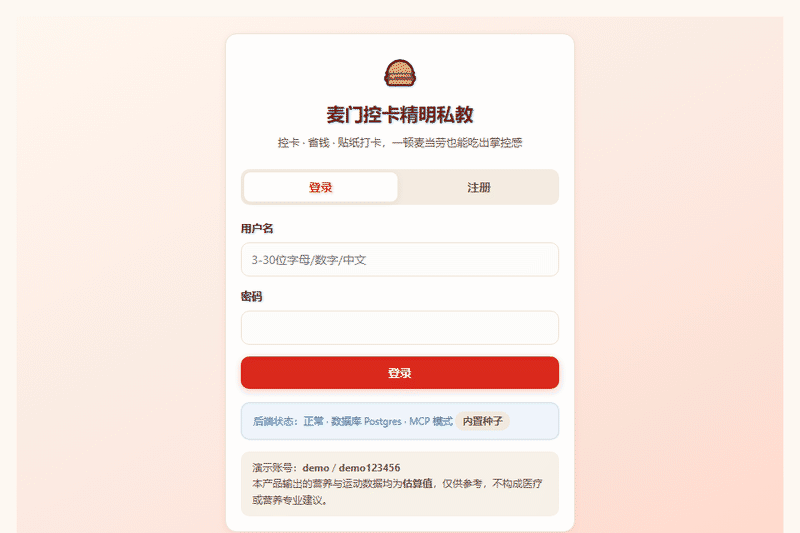
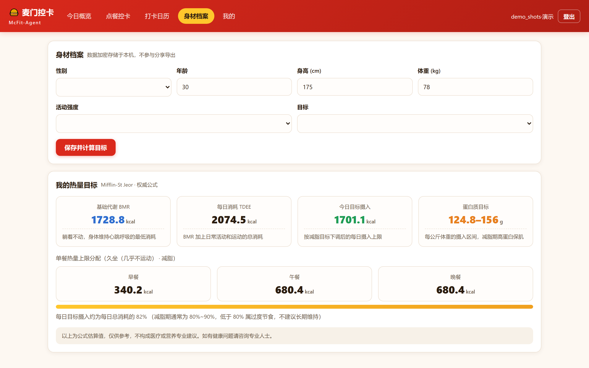
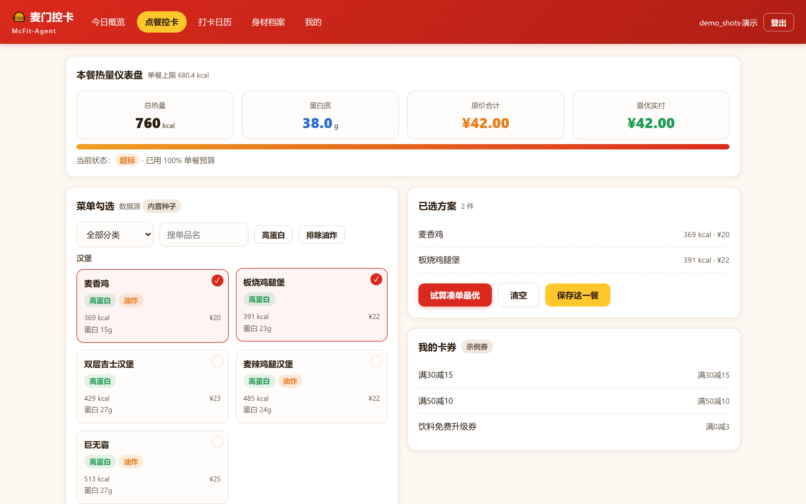
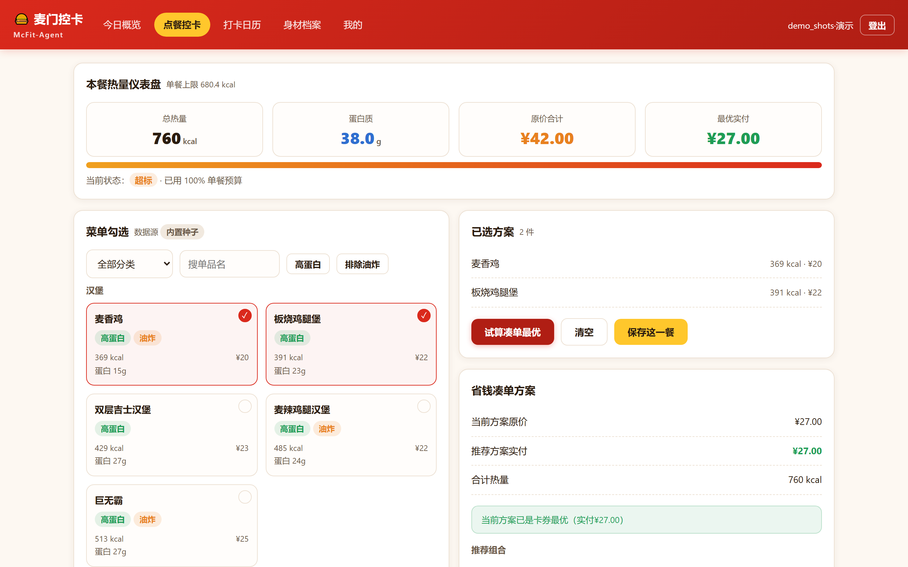
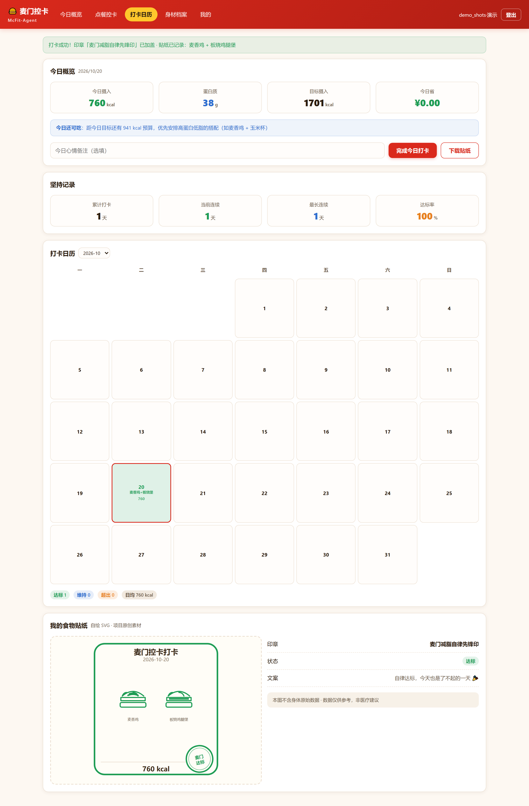

# 🍔 麦门控卡精明私教 (McFit-Agent)

> 减脂期还想吃麦当劳？**先建档，再点餐**——每一餐的热量、蛋白、券后实付，一目了然。一个麦当劳，也不会吃垮你的减脂计划。

   

⭐ **本仓库参加 2026 麦当劳程序员创意开发大赛，名次只看 Star 数。** 觉得"控卡的人也配吃麦当劳"这个思路有用，就点一下右上角那个 **Star** —— 这一票直接决定排名。



*▲ 30 秒完整流程：建档 → 热量预算 → 点餐控卡 → 凑单省钱 → 打卡贴纸（在线演示版实录）*

---

## ▶ 在线试玩（点开就用，不用装任何东西）

### 👉 [点我进在线演示版](https://zh0um0.github.io/McFit-Agent/) →

无需注册真实账号、无需 MCP Token、数据只存你自己的浏览器本地。填一个身材档案，30 秒看到你的专属热量预算。

想体验完整版（账号体系 / 官方 MCP 实时数据 / PostgreSQL）？往下看 [快速上手](#-快速上手完整版)。

---

## 🖼 它长什么样（真实运行截图）

| 身材档案 → 专属热量预算 | 点餐控卡：热量与实付毫秒级累加 |
| :---: | :---: |
|  |  |
| **省钱凑单：券后实付一目了然** | **打卡日历 + 自绘食物贴纸** |
|  |  |

> 在线演示版中所有数据为内置种子菜单（界面明确标注），克隆运行完整版后可接入麦当劳官方 MCP 实时数据。

---

## ✨ 三大功能点

### 1. 科学控卡：Mifflin-St Jeor 公式，不是拍脑袋

录入身材档案后自动算出你的 BMR / TDEE / 每日目标热量 / 蛋白质区间，
并精确拆分到早（20%）午（40%）晚（40%）三餐上限。点餐时热量与差额**毫秒级累加**。

### 2. 极致省钱：凑单算法帮你把券用满

结合卡券门槛做穷举比价，自动推荐「实付最低」组合 —— 当前方案 vs 推荐方案的差额一眼可见。

> 实测：麦香鸡 + 板烧鸡腿堡 原价 ¥42 → 券后实付 **¥27**，一单省 ¥15

### 3. 坚持可视化：自绘贴纸 + 打卡日历

每餐生成专属食物贴纸（**全部为项目内自绘 SVG 简笔图标**），
打卡日历按月展示达标/维持/超出，可一键导出分享 —— **海报默认脱敏，不含体重、TDEE 等身体数据**。

**⚠️ 免责声明：本项目所有营养与运动换算数据均为估算值，仅供参考，不构成医疗或营养专业建议。**


## 🛠 技术架构

```
[前端]  Vue 3 + Vite + Pinia + Vue Router（路由懒加载，gzip 后约 48 KB）
    │  JWT Bearer 自动刷新
    ▼
[后端]  FastAPI + SQLAlchemy 2.0（30 个 REST 接口，自动生成 Swagger 文档）
    │
    ├── 算法层  TDEE 代谢模型 / 运动代偿换算（正向激励口径）/ 优惠券凑单比价 / 自绘 SVG 贴纸引擎
    │
    ├── 协议层  MCP Streamable HTTP 客户端（JSON-RPC 2.0）
    │           ↓ 配置 MCP_TOKEN 时
    │      麦当劳官方 MCP Server (https://mcp.mcd.cn)
    │
    └── 数据层  SQLite 零配置（改 DATABASE_URL 即切 PostgreSQL）

[演示版] VITE_DEMO=1 构建 → 算法层整体移植到前端 + localStorage 持久化 → GitHub Pages 纯静态运行
```

### 调用的官方 MCP 工具（6 个，与 PRD 严格一致）

| Tool | 用途 |
|---|---|
| `list-nutrition-foods` | 官方真实热量、蛋白质、脂肪、碳水、钠 |
| `auto-bind-coupons` | 一键领券 |
| `query-my-coupons` | 读取卡包可用卡券 |
| `query-meals` | 门店实时可售菜单 |
| `calculate-price` | 折后实付价校验 |
| `campaign-calendar` | 今日特惠与会员日 |

未配置 Token 时自动降级到内置种子数据，**功能不降级**。

---

## 🔐 用户认证与隐私

| 能力 | 说明 |
|---|---|
| 注册 / 登录 | 用户名 + 密码 |
| 双令牌 JWT | access 2h + refresh 7d，前端 401 自动刷新并重放请求 |
| 暴力破解防护 | 连续 5 次失败锁定 15 分钟 |
| 用户枚举防护 | 用户名不存在与密码错误返回**完全相同**的文案 |
| 越权防护 | 所有个人数据查询以 token 中的 `user_id` 为准，无法跨用户访问 |
| 敏感字段加密 | 体重、目标体重、TDEE 以 Fernet 密文落库，密钥走环境变量 |

**隐私口径**：身体数据默认仅本地存储（`CLOUD_SYNC_ENABLED=false`），不参与任何云端同步，分享海报默认脱敏。在线演示版数据仅存于浏览器 localStorage。

---

## 🧪 验收与测试（104 项全绿）

```bash
# 后端：55 项自动化测试
cd backend
python -m pytest tests/ -v

# 端到端：浏览器真实流程验收（需前后端已启动）
node e2e/journey.spec.mjs        # 18 项：新手引导 / 路由守卫 / 档案页
node e2e/user-acceptance.mjs     # 31 项：点餐→凑单→打卡→贴纸→日历→海报脱敏→重登持久化
node e2e/demo-smoke.mjs          # 10 项：在线演示版构建冒烟
```

| 层级 | 覆盖内容 |
| :--- | :--- |
| 单元层 | TDEE 公式（含男女分支、极值边界）、运动换算精度、凑单最优性、券门槛判定、文案无空占位 |
| 接口层 | 注册/登录/刷新/改密、令牌类型混淆、账号锁定、越权访问、加密落库校验 |
| 端到端 | 档案 → 菜单 → 凑单 → 存档 → 打卡 → 日历 → 海报 完整链路 |
| 安全 | 越权删除他人记录、XSS 载荷、SQL 注入、用户枚举、暴力破解锁定、海报脱敏字段级校验 |

> 这套 E2E 曾抓出后端 55 项测试全绿时都没发现的 P0 Bug（不填邮箱的用户注册被误判「邮箱已注册」），详见[开发计划文档](docs/DEVELOPMENT_PLAN.md)第六章。

---

## 📁 项目结构

```
mcfit-agent/
├── backend/               FastAPI 源码 + 55 项测试
│   └── app/
│       ├── core/          配置、密码哈希、JWT、加密、鉴权依赖
│       ├── db/            引擎会话、ORM 模型、建表与种子
│       ├── services/      TDEE、运动换算、凑单算法、MCP 客户端、贴纸引擎
│       └── api/v1/        30 个 REST 接口
├── frontend/
│   └── src/
│       ├── api/           统一请求客户端（含 token 自动刷新 + demo 导流）
│       ├── demo/          演示版：算法前端移植 + localStorage 持久化
│       ├── stores/        Pinia 状态
│       └── views/         登录/概览/点餐/打卡/档案/我的
├── e2e/                   3 个 E2E 验收脚本（59 项断言）
├── docs/                  PRD / 开发计划 / MCP 集成说明 / 截图
├── .github/workflows/     GitHub Pages 演示版自动部署
├── start.bat / start.sh   一键启动
└── mcp-config.example.json
```

---

## 🔒 合规声明

- 贴纸图标**全部为项目内自绘 SVG 简笔图标**，不使用麦当劳官方 Logo、餐品实拍图或官方物料
- 代码中**零硬编码密钥**，所有凭据走环境变量
- 不调用 `create-order`，不产生任何真实订单与支付行为
- 营养数据为估算参考值，实时以官方渠道为准

---

## 📄 相关文档

- [产品需求与架构规划文档 (PRD)](docs/PRD.md)
- [MCP 集成说明](docs/MCP_INTEGRATION.md)
- [开发计划与验收方案](docs/DEVELOPMENT_PLAN.md)
- [WorkBuddy 开发过程记录](workbuddy.md)
